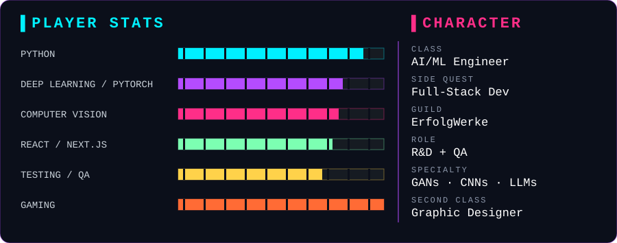
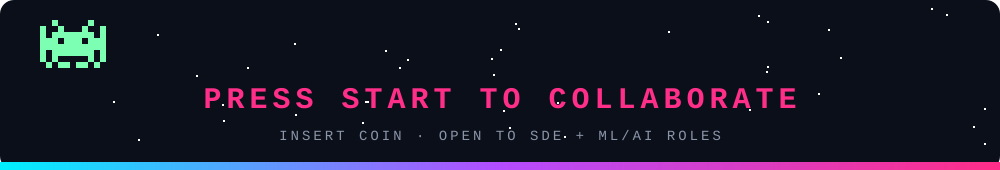

 

---

## 🎮 PLAYER PROFILE

> **Class:** AI/ML Engineer  ·  **Side quest:** Full-Stack Developer  ·  **Second class:** Graphic Designer

Recent B.Tech CSE (Data Science) graduate from MCKV Institute of Engineering (**CGPA 9.29**), working as an **R&D and QA Engineer at ErfolgWerke**. I train models that see (GANs, CNNs), build apps that talk (LLMs), and break software for a living. When the keyboard is free, I'm gaming or designing.

---

## ⚔️ CURRENT QUEST

**R&D + QA Engineer @ ErfolgWerke**: testing and shipping for a cooperative-management SaaS built for the German market.

- 🧪 Tested a 27-feature, 9-module platform against legal acceptance criteria across 5 user roles
- 🛡️ Hunted security bugs (trust-boundary violations) in legally significant workflows
- 🚀 Deployed Frappe CRM + ERPNext on Ubuntu with Nginx, Supervisor and SSL
- 🤖 Building an LLM-powered email agent that replies by rules and escalates the hard cases to Telegram

---

## 🗺️ QUEST LOG

| 🏆 Quest | 📜 What it does | 🧰 Loot |
|---|---|---|
| **Fingerprint Inpainting with GANs** | Restores damaged fingerprints with a Residual Attention U-Net generator and PatchGAN discriminator (PSNR 28.74 dB, SSIM 0.912) | `PyTorch` `GAN` `Computer Vision` |
| **[VisualLens](https://github.com/arghasoni/Intale-Visual-Search-Streamlit)** | Triplet-network image search: 128-D embeddings and FAISS retrieval, no tags needed | `PyTorch` `FAISS` `Streamlit` |
| **Grad-CAM Explorer** | Compares how VGG16, ResNet and XceptionNet "see" (79% Top-1 on PASCAL VOC 2012) | `Explainable AI` `CNN` |
| **[Sentiment Chatbot](https://github.com/arghasoni/Chatbot_Sentiment_Analyser)** | Gemini chatbot with message-level and conversation-level sentiment | `Flask` `Gemini API` `SQLite` |
| **[DevNotes](https://github.com/arghasoni/devnotes)** · [live](https://devnotes-argha.vercel.app) | A notes app for developers: markdown, code snippets, images and public share links | `TypeScript` `Appwrite` `Vercel` |
| **[SmartFill](https://github.com/arghasoni/SmartFill)** | Manifest V3 Chrome extension that autofills forms, 100% locally | `JavaScript` `Chrome Extension` |
| **[Football Globe 3D](https://github.com/arghasoni/football-globe-3d)** | Rotatable 3D globe with live scores, fixtures and a match centre | `React` `globe.gl` `Hono` |

---

## 🎒 INVENTORY

---

## 📊 SCOREBOARD

 

<picture>
  <source media="(prefers-color-scheme: dark)" srcset="https://raw.githubusercontent.com/arghasoni/arghasoni/output/github-snake-dark.svg"/>
  
</picture>

---

